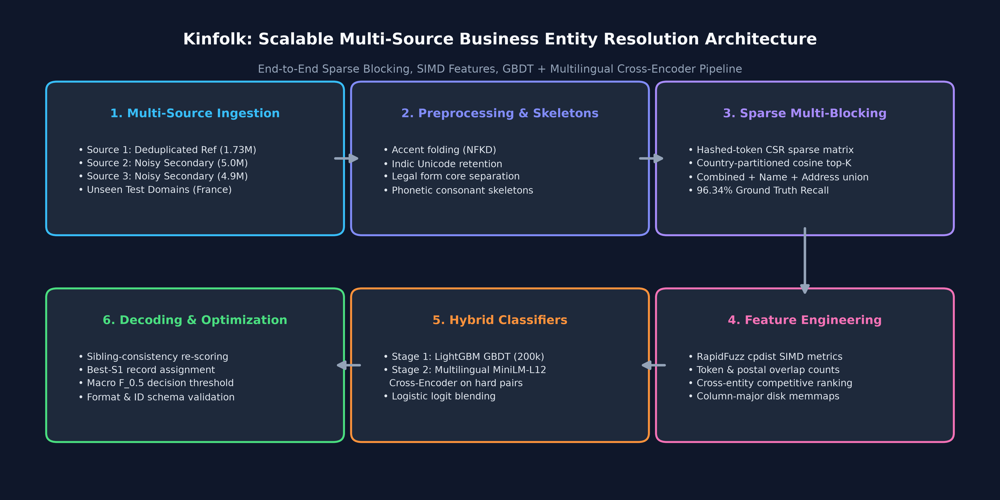
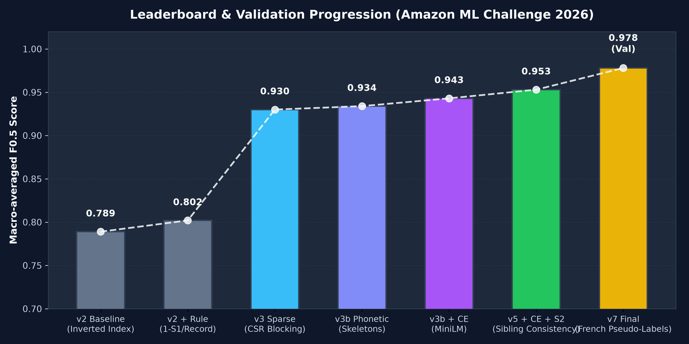

# Amazon ML Challenge 2026 — Business Entity Resolution (Kinfolk)

[](https://github.com/vinay3254/Merlin/actions/workflows/ci.yml)
[](https://github.com/vinay3254/Merlin/actions/workflows/submission_validation.yml)
[](https://www.python.org/)
[](https://github.com/vinay3254/Merlin)
[](https://github.com/vinay3254/Merlin)

High-performance, scalable entity resolution pipeline built for the **Amazon ML Challenge 2026: Business Entity Resolution Challenge**. Resolves millions of noisy, heterogeneous business records across multiple sources under tight RAM and compute budgets.

---

## 📌 Problem Overview

In commercial platforms, business identity data originates from multiple independent data sources without shared identifiers. This project resolves records across 3 independent sources:
- **Source 1 (`S1`):** Deduplicated reference source (1.73M entities in test, 2.2M in train).
- **Source 2 (`S2`) & Source 3 (`S3`):** Noisy secondary sources (~10M entities).
- **Objective:** For every Source 1 entity, find all matching entities in Source 2 and Source 3 (zero, one, or many).

### 📊 Evaluation Metric

Submissions are evaluated using **Macro-averaged $F_{0.5}$ score** across all Source 1 entities:

$$F_{0.5} = \frac{1.25 \times \text{Precision} \times \text{Recall}}{0.25 \times \text{Precision} + \text{Recall}}$$

- **Precision-Weighted:** Penalizes false merges $2\times$ harder than missed matches ($\beta = 0.5$).
- **Singletons Scored:** Correctly predicting no matches yields $1.0$; a false match yields $0.0$.

---

## 🏗️ System Architecture



The pipeline (**Kinfolk**) operates through a multi-stage architecture designed for massive scale without building dense cross-source matrices:

1. **Multilingual Normalization & Consonant Skeletons:**
   - NFKD Unicode accent folding (preserving native Indic scripts).
   - Legal form core separation (*Corp*, *Pvt*, *Ltd*, *GmbH*, *SARL*, *SAS*).
   - Address standardization (US states, French départements/régions, Indian administrative divisions).
   - Phonetic consonant skeletons for phonetically aligned fuzzy matching.

2. **Multi-Strategy Sparse Blocking:**
   - Hashed-token CSR sparse matrix cosine top-$k$ partitioned by country.
   - Union of combined top-40, name+skeleton top-20, and address top-20.
   - Delivers **96.34% ground-truth candidate recall** at only ~62 candidate pairs per entity.

3. **SIMD-Accelerated Feature Engineering:**
   - RapidFuzz SIMD string distances (Levenshtein, token sort, Jaccard).
   - Numeric token & postal code overlap counts.
   - Competitive context metrics (rank & score margin within entity and among competing S1 candidates).
   - Memory-mapped arrays written in column-major layout for disk-backed zero-copy streaming.

4. **Two-Stage Hybrid Ranker & Cross-Encoder:**
   - **Stage 1 (LightGBM GBDT):** Binary classifier trained on 200,000 entities with hard negative mining.
   - **Stage 2 (Multilingual MiniLM-L12 Cross-Encoder):** Re-scores uncertain candidate pairs in the $[0.005, 0.995]$ boundary band.
   - Optimal logit blending via logistic regression fitted on validation data.

5. **Post-Processing & Optimal 1-to-1 Assignment:**
   - Sibling consistency scoring across multi-record entities.
   - Best-S1 assignment enforcing single-source uniqueness constraints.
   - Decision threshold tuned directly for Macro $F_{0.5}$.

---

## 📈 Leaderboard & Validation Progression



| Version | Description | Valid F0.5 | Public LB |
| :--- | :--- | :---: | :---: |
| **v2** | Inverted token index baseline | 0.792 | 0.789 |
| **v2 + Rule** | One-S1-per-record post-processing rule | 0.811 | 0.802 |
| **v3** | Country-partitioned CSR sparse blocking | 0.941 | 0.930 |
| **v3b** | Legal form detachment + phonetic consonant skeletons | 0.948 | 0.934 |
| **v3b + CE** | Multilingual MiniLM-L12 cross-encoder re-ranking | 0.959 | 0.943 |
| **v5 + CE + S2** | Sibling-consistency context + calibrated blend | 0.976 | **0.953** |
| **v7 (Final)** | French pseudo-labels + wider re-scoring uncertainty band | **0.9786** | Candidate |

---

## 📁 Repository Structure

```
.
├── .github/
│   └── workflows/
│       ├── ci.yml                           # GitHub Actions CI (matrix tests & lint)
│       └── submission_validation.yml        # Submission schema verification workflow
├── code/business_entity_resolution/
│   ├── src/                                 # Active v3 pipeline modules
│   │   ├── blocking_v3.py                   # Sparse CSR candidate blocking
│   │   ├── normalize_v3.py                  # Normalization & phonetic skeletons
│   │   ├── features_v3.py                   # RapidFuzz SIMD feature extraction
│   │   ├── cross_encoder.py                 # Multilingual MiniLM cross-encoder
│   │   ├── blend_cli.py                     # Logistic blend of GBDT + CE
│   │   ├── stage2_cli.py                    # Sibling-consistency stage 2
│   │   ├── train.py / infer.py              # LightGBM training & prediction
│   │   └── metrics.py                       # Exact competition Macro F0.5 scorer
│   ├── tests/                               # 92 unit tests covering all components
│   ├── requirements.txt                     # Production requirements
│   └── pytest.ini                           # Test suite configuration
├── docs/
│   ├── images/
│   │   ├── architecture.png                 # Architecture diagram
│   │   └── leaderboard_progress.png         # Benchmark progression chart
│   └── generate_diagrams.py                 # Diagram generation script
├── student_resource/
│   ├── Documentation.md                     # Final methodology write-up
│   ├── utils/validate_submission.py         # Official format & schema validator
│   └── dataset/                             # Data directory (ignored in git)
├── CLAUDE.md                                # Comprehensive developer guide
├── HANDOFF.md                               # Detailed engineering log & session history
└── README.md
```

---

## 🚀 Quickstart & Reproduction

### 1. Environment Setup

```bash
# Clone repository
git clone https://github.com/vinay3254/Merlin.git
cd Merlin

# Create and activate virtual environment
python3 -m venv .venv
source .venv/bin/activate

# Install dependencies
pip install -r code/business_entity_resolution/requirements.txt
```

### 2. Run Test Suite

```bash
PYTHONPATH=code/business_entity_resolution/src pytest code/business_entity_resolution/tests
```

### 3. Validate Submission

Always validate submission files against official constraints before upload:

```bash
python3 student_resource/utils/validate_submission.py \
    --matching output/matching_results.tsv \
    --candidate output/candidate_pairs.tsv \
    --test-dir student_resource/dataset/test \
    --check-ids
```

---

## 📜 Documentation

- [CLAUDE.md](CLAUDE.md): Guide to architecture, invariants, and memory constraints.
- [HANDOFF.md](HANDOFF.md): Full narrative of all experiments, ablations, and design decisions.
- [Documentation.md](student_resource/Documentation.md): Competition methodology write-up.
